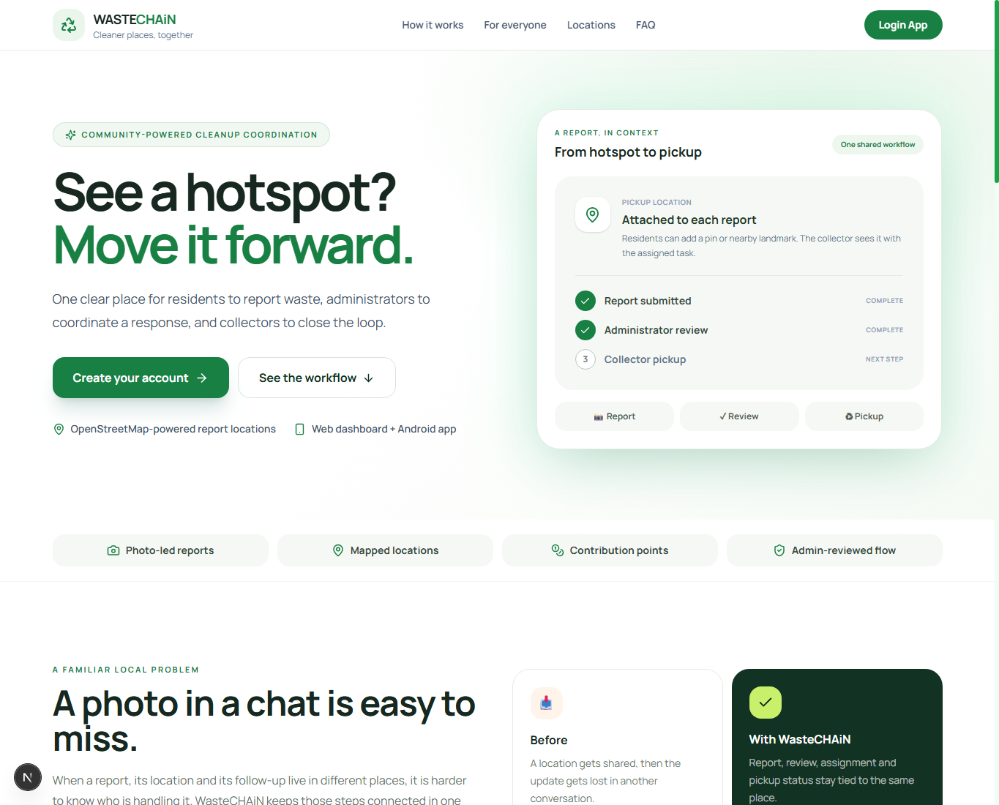

# WasteCHAiN

**Cleaner places, together.** WasteCHAiN connects residents who report waste, administrators who coordinate a response, and approved collectors who complete pickups. The web dashboard and Expo mobile app use the same PostgreSQL-backed service.

<p align="center">
  
</p>

<p align="center">
  <a href="#screenshots">Screenshots</a> · <a href="#features">Features</a> · <a href="#run-locally">Run locally</a> · <a href="#mobile-app-setup">Mobile app</a> · <a href="#configuration">Configuration</a>
</p>

    

## Screenshots

### Web landing page



Screenshots are stored in [`web/docs/screenshots`](web/docs/screenshots). The landing screenshot above is from the web app.

## Features

- **Resident reporting:** submit a waste report with type, amount, photo, and a mapped location; view progress and earned contribution points.
- **Collector workflow:** residents can request collector access; an administrator approves the role. Approved collectors see assigned pickups and update collection status in the mobile app.
- **Admin coordination:** review the shared report queue, approve collector requests, assign pickups, and inspect account and activity data.
- **Web and Android clients:** Next.js web dashboard and an Expo Router app connect to the same backend and database.
- **Authentication:** Web3Auth social sign-in on web and phone OTP on mobile. Mobile OTP supports Twilio Verify, with a development-only fixed OTP option.
- **Location maps:** Leaflet with OpenStreetMap tiles and attribution. No Google Maps key is required. Mobile displays its map in a WebView.
- **Points and activity:** report/collection points, rewards, leaderboard, notifications, and transaction history are stored as application data. They are not cryptocurrency or a cash payout.
- **Optional report assistance:** Gemini-backed report verification is configured on the server. Keep the API key private.

## How the workflow fits together

```text
Resident submits a report (photo + location)
                 ↓
       Admin reviews the queue
                 ↓
 Admin assigns an approved collector
                 ↓
 Collector picks up waste and updates status
                 ↓
 Shared report status, points, and activity
```

### Account roles

| Role | How it is granted | Main actions |
|---|---|---|
| Resident | Default for a new account | Submit reports, follow status, earn points |
| Collector | Resident requests access; admin approves it | View assigned work and update pickup status |
| Admin | Web account matches configured `ADMIN_EMAIL` | Review reports, manage roles, assign work, view dashboard |

## Tech stack

| Area | Implementation |
|---|---|
| Web | Next.js 15 App Router, React 19, TypeScript, Tailwind CSS 4 |
| Mobile | Expo 57, Expo Router, React Native 0.86, TypeScript |
| Database | PostgreSQL (Neon-compatible) with Drizzle ORM |
| Web sign-in | Web3Auth, verified by the server before a signed application session is issued |
| Mobile sign-in | Phone OTP, server-issued access and refresh sessions; Twilio Verify for deployed SMS |
| Maps | Leaflet + OpenStreetMap tiles; mobile map in `react-native-webview` |
| Report assistance | Google Gemini API, server-side only |

## Repository layout

```text
web/                      Next.js frontend and HTTP route adapters
  src/app/                Pages, layouts, and /api routes
  src/components/         Web UI components
  src/server/             Web session adapter
  public/                 Web static assets
  docs/                   Web documentation and screenshots
  next.config.ts          Next.js configuration
  postcss.config.mjs      Tailwind/PostCSS configuration
  components.json         Web UI component generator config
  eslint.config.mjs       Web lint configuration
  tsconfig.json           Web TypeScript configuration
  package.json            Web dependencies and commands
  package-lock.json       Locked web dependencies
backend/                  Shared server-side domain and data layer
  src/db/                 Drizzle schema, queries, and SQL migration
  src/                    Auth, OTP, session, and verification services
  drizzle.config.js       Database schema/migration config
  tsconfig.json           Backend TypeScript configuration
  package.json            Backend dependencies and database commands
  package-lock.json       Locked backend dependencies
  .env.example            Backend/web server configuration template
mobile/                   Expo React Native Android/iOS app
  app/                    Expo Router screens and tabs
  components/             Mobile UI and map components
  utils/                  Mobile API and impact helpers
  app.config.ts            Expo app configuration
  eas.json                EAS build profiles
  package-lock.json       Locked mobile dependencies
  package.json            Mobile dependencies and Expo commands
README.md                 Project overview and setup guide
.gitignore                Shared ignore rules
```

The Next.js `/api/*` files are HTTP adapters because Next hosts those routes. Database access, authentication/session logic, OTP, and verification services live separately under `backend/src` and are imported through the `@backend/*` alias.

## Run locally

### Prerequisites

- Node.js 20 or newer and npm
- PostgreSQL database (Neon works)
- Web3Auth project credentials for web sign-in
- Twilio Verify credentials for real mobile SMS; a local development OTP can be used without Twilio

### 1. Install and configure the backend

From the repository root, install the backend dependencies and create its environment file:

```bash
cd backend
npm install
cp .env.example .env
```

Fill in the values described in [Configuration](#configuration). Keep `backend/.env` private and never commit it.

Apply the Drizzle schema to your database:

```bash
npm run db:push
```

For the phone OTP and referral fields, also apply [`backend/src/db/phone-auth-migration.sql`](backend/src/db/phone-auth-migration.sql) to the same PostgreSQL database (for example, with the Neon SQL editor). Do this once before testing mobile phone sign-in.

### 2. Start the web app and its API

In another terminal, from the repository root:

```bash
cd web
npm install
npm run dev
```

Open [http://localhost:3000](http://localhost:3000).

### 3. Start the mobile app

In another terminal:

```bash
cd mobile
npm install
```

Create `mobile/.env` with the URL your phone can reach:

```env
EXPO_PUBLIC_API_URL=http://<your-computer-LAN-IP>:3000
```

The phone and computer should be on the same Wi-Fi when using a LAN URL. Start the web API on the LAN interface, then start Expo:

```bash
cd web
npm run dev -- --hostname 0.0.0.0
```

From `mobile/`, start Expo in another terminal:

```bash
npx expo start --tunnel
```

Open the project in Expo Go using the displayed development URL, or scan its QR code. The mobile project includes `expo-dev-client`; if Expo Go reports that a native module is unavailable, use an Android development build (`npx expo run:android`) or an EAS development build. Android location permission is needed for current-location features.

## Configuration

The [`backend/.env.example`](backend/.env.example) file lists backend and web server variables. Set real credentials in `backend/.env`; do not paste secrets into source code or `EXPO_PUBLIC_*` values. The mobile app has a separate [`mobile/.env.example`](mobile/.env.example) for public client settings such as its API URL.

| Variable | Purpose |
|---|---|
| `DATABASE_URL` | PostgreSQL connection string |
| `NEXT_PUBLIC_WEB3_AUTH_CLIENT_ID` | Public Web3Auth client ID used by the web client (the login UI also accepts the spelling without the second underscore) |
| `ADMIN_EMAIL` | Web account promoted to the administrator role |
| `ADMIN_SESSION_SECRET` | Signs the web admin session; use a random secret of at least 32 bytes |
| `MOBILE_AUTH_SECRET` | Signs mobile access/refresh sessions; use a separate random secret of at least 32 bytes |
| `GEMINI_API_KEY` | Server-side report verification key |
| `TWILIO_ACCOUNT_SID`, `TWILIO_AUTH_TOKEN`, `TWILIO_VERIFY_SERVICE_SID` | Twilio Verify SMS configuration for mobile OTP |
| `DEV_OTP_CODE` | Optional six-digit OTP for non-production local development only |

For local OTP testing without Twilio, set `DEV_OTP_CODE` in `backend/.env` while `NODE_ENV` is not `production`. The development endpoint returns the configured code to the app, so never enable this in a deployed environment. Do not put any of the server secrets in `mobile/.env`.

Web3Auth must be configured for the exact app client ID and allowed origins used by your local/deployed web app. The server verifies the returned token against that app configuration before issuing its session; a client ID or verifier mismatch will reject sign-in.

## Maps and attribution

The web report location picker and dispatch map use Leaflet. The mobile tracking map renders the same Leaflet/OpenStreetMap approach inside Expo WebView, avoiding a Google Maps SDK or key. See [`mobile/MAPS_SETUP.md`](mobile/MAPS_SETUP.md). Keep OpenStreetMap attribution visible and follow the public tile service usage policy; use a hosted tile provider or self-hosted tiles if production usage grows beyond normal interactive access.

## Useful commands

Run these commands from the matching app folder:

| Folder | Commands |
|---|---|
| `web/` | `npm run dev`, `npm run build`, `npx tsc --noEmit` |
| `backend/` | `npm run db:push`, `npm run typecheck` |
| `mobile/` | `npx expo start --tunnel`, `npm run typecheck` |

## Notes

- Points are in-app contribution/reward records. No token minting, blockchain payout, exchange conversion, or cash redemption is implemented by this README's documented workflow.
- Gemini verification depends on a valid server-side key and network access. The report form and stored report data remain part of the app workflow.
- OpenStreetMap tiles require internet access unless you configure an offline-capable tile service separately.

---

Built for cleaner neighborhoods and a clearer path from report to pickup.
